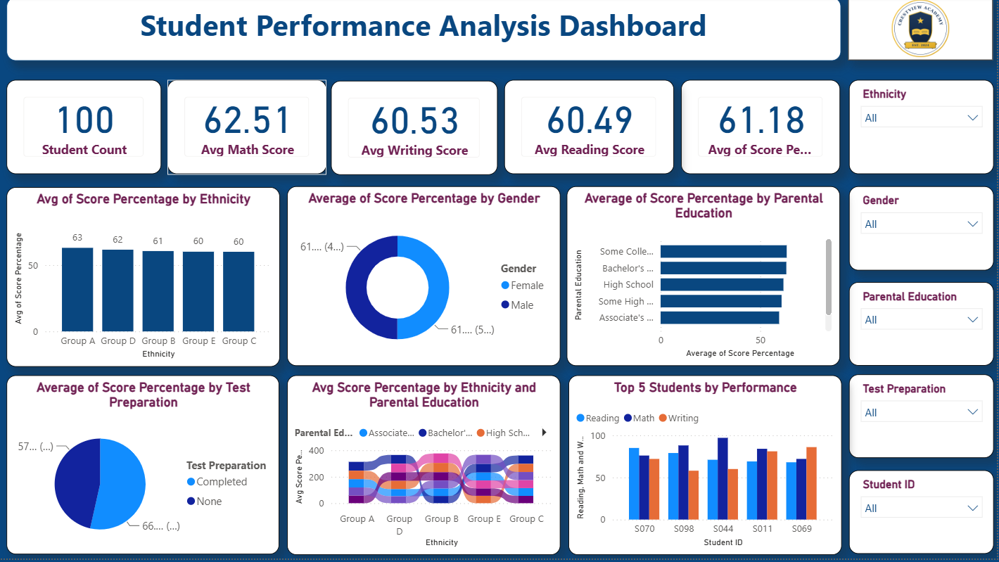

# 📊 Student Performance Analysis Dashboard
## A Power BI Project Exploring What Drives Student Performance

---

# 📖 Project Overview

This dashboard was built during the first week of my Data Analytics internship at SyntecxHub.

The project analyzes student exam performance using Power BI to uncover which factors are most strongly associated with higher or lower academic outcomes — including test preparation, parental education level, ethnicity, and gender.

One interactive dashboard was developed to allow stakeholders to explore performance from multiple angles and identify where intervention could have the greatest impact.

---

# 🎯 Project Objective

The objective of this project was to apply the core data analytics workflow to a real-world-style question by:

- Preparing and modeling the dataset
- Building KPI cards and interactive visuals in Power BI
- Identifying which student factors most affect performance
- Communicating findings clearly through visualization

---

# 📂 Dataset

The project was developed using a public student performance dataset ("Marks" table) containing 100 student records, with the following fields:

- Student ID
- Gender
- Ethnicity (Group A–E)
- Parental Education Level
- Test Preparation Status (Completed / None)
- Math Score
- Reading Score
- Writing Score
- Score Percentage

---

# 🛠 Tools Used

- 📊 Microsoft Power BI
- 📈 DAX (Data Analysis Expressions)
- 📂 Public Student Performance Dataset

---

# 📊 Dashboard — Student Performance Overview

### KPIs

- 👥 Student Count
- 📈 Average Score Percentage
- ➗ Average Math Score
- 📖 Average Reading Score
- ✏️ Average Writing Score

### Visualizations

- Score Percentage by Ethnicity (Column Chart)
- Average Score Percentage by Gender (Donut Chart)
- Average Score Percentage by Parental Education (Clustered Bar Chart)
- Average Score Percentage by Test Preparation (Pie Chart)
- Score Percentage Trend by Parental Education and Ethnicity (Ribbon Chart)
- Math, Reading, and Writing Scores by Student (Clustered Column Chart)
- Slicers for Ethnicity, Gender, Parental Education, Test Preparation, and Student ID

### Key Findings

- Test preparation had the strongest effect on performance: students who completed it averaged **66.3%**, compared to **57.6%** for those who did not — an **8.8 percentage point gap**.
- Ethnicity showed some variation, with Group A scoring highest (63.0%) and Groups C and E scoring lowest (around 60%).
- Parental education did not follow a clean upward trend — students with Some College or Bachelor's-level parental education averaged around 63%, while Associate's and Master's groups averaged lower (around 59%).
- Gender made almost no difference in average performance (61.3% for female students vs. 61.1% for male students).

---

# 📈 Insights

- Test preparation is the single most actionable factor in the dataset, outweighing gender, ethnicity, and parental education combined.
- Demographic factors alone do not reliably predict performance — behavioral factors like test prep completion matter more.
- Some subgroup breakdowns (e.g., Some College, Master's Degree) are based on relatively small sample sizes (13–14 students each) and should be interpreted with that in mind.

---

# 💡 Recommendations

- Prioritize test-prep access for students, since it is the single most actionable lever in the data, worth a full 9-point average swing.
- Investigate the parental-education pattern further rather than assuming a linear relationship, since the data does not show one.
- Flag low sample sizes on any subgroup breakdown so stakeholders do not over-read small-group averages.
- Continue monitoring performance by demographic and preparation status to track whether the test-prep gap holds as more data is collected.

---

# ⚠️ Project Limitation

The dataset contains 100 student records, which means some subgroup comparisons (by ethnicity or parental education) are based on small sample sizes. Findings at the subgroup level should be treated as directional rather than statistically conclusive.

---

# 📚 Skills Demonstrated

- Data Modeling
- KPI Design
- Dashboard Design
- Data Visualization
- DAX
- Business Intelligence
- Insight Generation

---

# 📌 Conclusion

This project demonstrates the core data analytics workflow using Power BI — from raw exam data to an interactive dashboard capable of answering a focused business question: which factors most influence student performance, and where should a school focus its efforts.

---

## 👩‍💻 Developed By

Esther Jimbo

---

#PowerBI #DataAnalytics #BusinessIntelligence #DataVisualization #Dashboard #StudentPerformance
